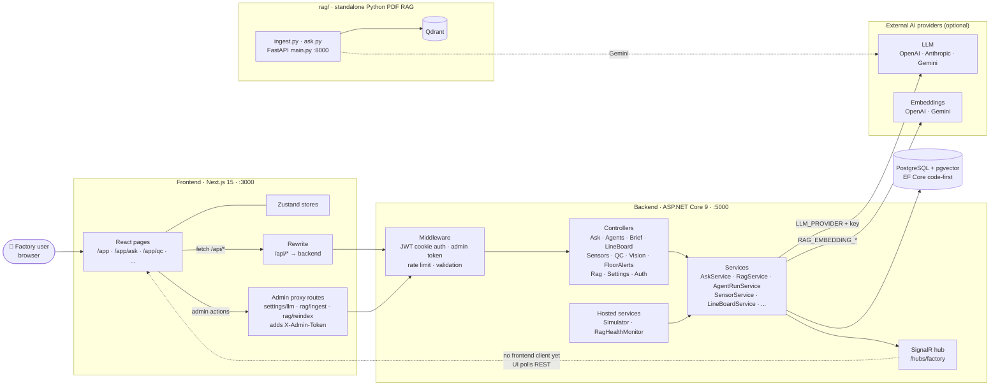
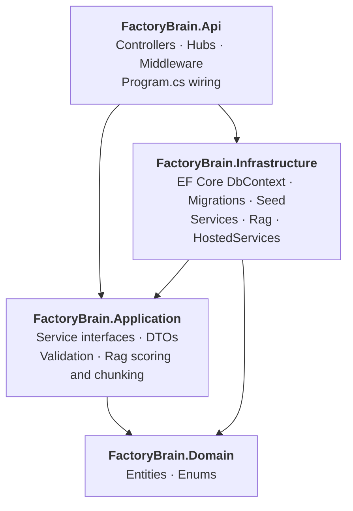
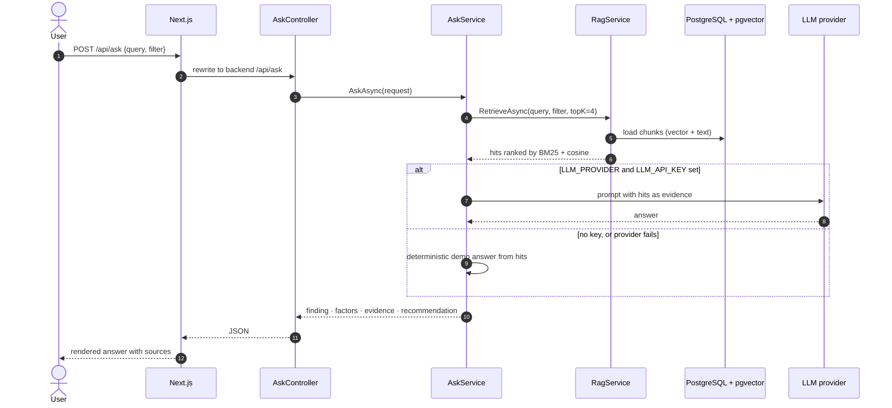
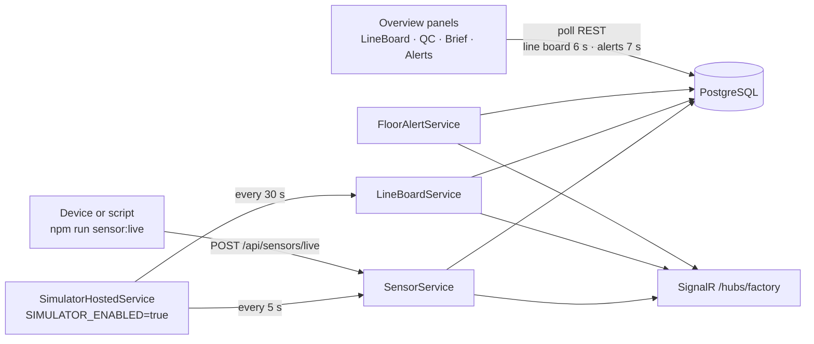
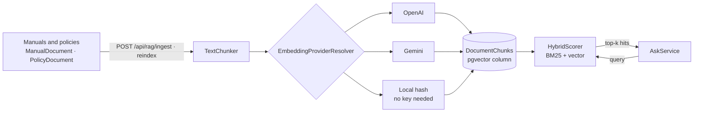
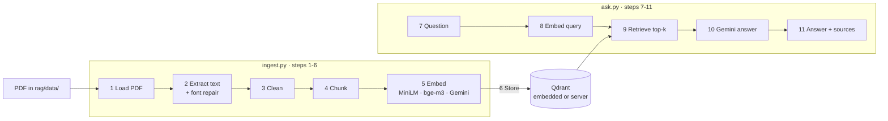
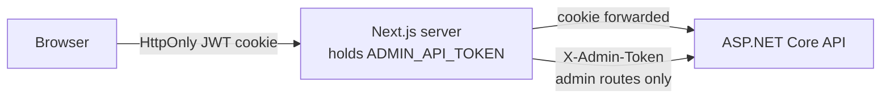

# Architecture

How FactoryBrain fits together: what runs where, how a request moves through the
system, and where data lives. The diagrams are [Mermaid](https://mermaid.js.org/)
and render on GitHub and in the VS Code Markdown preview.

- [1. System overview](#1-system-overview)
- [2. Backend layers](#2-backend-layers)
- [3. Ask BunonBrain request flow](#3-ask-bunonbrain-request-flow)
- [4. Live floor data](#4-live-floor-data)
- [5. Backend RAG](#5-backend-rag)
- [6. Standalone Python RAG (`rag/`)](#6-standalone-python-rag-rag)
- [7. Security boundaries](#7-security-boundaries)

---

## 1. System overview

Notes:

- The browser only ever talks to Next.js. Every `/api/*` call is rewritten to the
  .NET backend ([frontend/next.config.mjs](frontend/next.config.mjs)). The three
  admin routes are real Next.js route handlers, so the server can attach
  `ADMIN_API_TOKEN` without exposing it to the browser
  ([frontend/src/lib/adminProxy.ts](frontend/src/lib/adminProxy.ts)).
- The backend owns all data and all AI calls. With no LLM key it returns
  deterministic demo answers; with no embedding key RAG uses a local hash vectorizer.
- The SignalR hub broadcasts `sensorReading`, `lineBoardUpdated` and `floorAlert`,
  but the frontend does not subscribe yet. Panels poll REST endpoints instead.
- `rag/` is **not connected** to the backend. It is a separate tool with its own
  vector store (Qdrant).

---

## 2. Backend layers

The .NET solution in [FactoryBrain.Backend/](FactoryBrain.Backend/) follows a
clean-architecture split. Arrows point at the project being referenced.

| Layer | Holds |
|---|---|
| Domain | Entities such as `SensorReading`, `LineBoardMetric`, `QcDefect`, `FloorAlert`, `ManualDocument`, `PolicyDocument`, `AgentDefinition`, `ApprovalRequest`, `User` |
| Application | `IAskService`, `IRagService`, `IRealtimeNotifier` and other seams, request/response DTOs, FluentValidation rules, `TextChunker`, `HybridScorer`, `RagSynonyms` |
| Infrastructure | `FactoryBrainDbContext`, migrations, `DbInitializer` seed, service implementations, embedding providers, `SimulatorHostedService` |
| Api | Attribute-routed controllers, `FactoryHub`, auth and admin-token filters, global exception handler, rate limiter |

---

## 3. Ask BunonBrain request flow

What happens when someone types a question on **/app/ask**.

---

## 4. Live floor data

Sensor readings either come from the built-in simulator or are pushed by a real
device or script. Panels on the Overview page poll for updates.

Details: [docs/SENSORS.md](docs/SENSORS.md) (local docs folder).

---

## 5. Backend RAG

The RAG that powers **Ask** lives inside the backend and stores vectors in the
same PostgreSQL database.

- Weights for BM25 and vector scoring are configurable (`RagConfig`,
  `RAG_HYBRID_*` env vars). If the active embedder's dimension does not match
  the stored column, ranking falls back to BM25 only instead of failing.
- `RagHealthMonitor` re-probes the embedding provider every
  `RAG_HEALTH_INTERVAL_SECONDS` (default 300) and runs a one-shot reindex when
  the provider recovers from degraded mode.
- Index management: `/api/rag/{ingest,reindex,documents,status}`. Ingest and
  reindex need the admin token.

---

## 6. Standalone Python RAG (`rag/`)

A separate PDF question-answering pipeline: LangChain, Qdrant and Gemini.
It does not share data with the backend.

- CLI: `python ingest.py --pdf data/file.pdf --recreate`, then `python ask.py "question"`.
- HTTP: `uvicorn main:app --port 8000` serves the same pipeline with one Qdrant
  collection per knowledge base. This needs Qdrant in server mode.
- Setup and details: [rag/README.md](rag/README.md).

---

## 7. Security boundaries

| Control | Where |
|---|---|
| Login, refresh, logout, current user | `/api/auth/*`, JWT in an HttpOnly cookie. `JWT_SIGNING_KEY` (32+ bytes) is required in Production |
| Admin-only routes | `POST /api/settings/llm`, `/api/rag/ingest`, `/api/rag/reindex`, guarded by `ADMIN_API_TOKEN` (`AdminTokenAuthorizationFilter`) |
| Login brute force | Per-IP fixed-window rate limiter (`login` policy) |
| Input validation | FluentValidation filter on every controller |
| Error leakage | `GlobalExceptionHandler` returns ProblemDetails with a trace id. The exception message is included only in Development |
| Python RAG service | Optional `PYRAG_API_KEY`, sent as `X-Rag-Api-Key` |

Known open findings are tracked in [docs/SECURITY_ANALYSIS.md](docs/SECURITY_ANALYSIS.md) (local docs folder).
