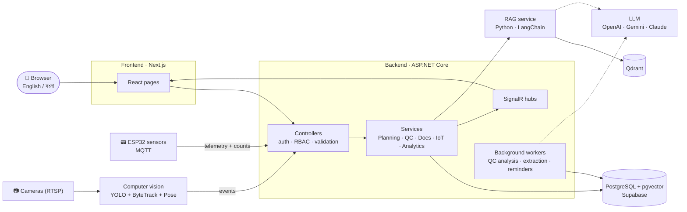

<div align="center">

# 🧵 BunonBrain: Competition Kit

**The AI operations platform for Bangladeshi garment (RMG) factories**
*Smart Workforce. Stronger RMG.*

This file covers the pitch, the full feature list, how each part was built, the presentation
plan and a scene-by-scene **video script**.

</div>

---

## Contents

1. [The pitch in 30 seconds](#1-the-pitch-in-30-seconds)
2. [The problem](#2-the-problem)
3. [Our solution](#3-our-solution)
4. [Full feature list](#4-full-feature-list)
5. [How we built it (tech stack)](#5-how-we-built-it-tech-stack)
6. [Architecture](#6-architecture)
7. [Where and how we use AI](#7-where-and-how-we-use-ai)
8. [Security, privacy and responsible AI](#8-security-privacy-and-responsible-ai)
9. [Engineering quality: numbers](#9-engineering-quality-numbers)
10. [What is real vs simulated](#10-what-is-real-vs-simulated)
11. [Impact and business value](#11-impact-and-business-value)
12. [Roadmap](#12-roadmap)
13. [Presentation plan (slides)](#13-presentation-plan-slides)
14. [Video plan and script](#14-video-plan-and-script)
15. [Recording checklist](#15-recording-checklist)
16. [Judge Q&A preparation](#16-judge-qa-preparation)

---

## 1. The pitch in 30 seconds

> Bangladesh's garment industry runs on paper registers, WhatsApp messages and Excel sheets.
> A production manager finds out a line is behind plan at the end of the shift, a defect
> batch after the buyer rejects it, and a missing tech-pack value after cutting has started.
>
> **BunonBrain** puts the whole factory on one screen: live machine and line data from IoT
> sensors, AI quality inspection from a phone photo, camera-based floor monitoring, production
> planning, 38 kinds of factory documents generated automatically, and an AI assistant that
> answers from the factory's own manuals, in **English and বাংলা**.
>
> Every risky AI action waits for a human to approve it, and every decision is audited.

**One line:** *BunonBrain is the "brain" of a garment factory: it sees, counts, checks, plans
and explains, and a human stays in charge.*

---

## 2. The problem

Bangladesh is one of the world's largest garment exporters, and the RMG sector earns most of the
country's export income and employs millions of workers, most of them women.
*(Check the latest BGMEA / EPB figures before quoting exact numbers on a slide.)*

Inside a typical mid-sized factory we found these problems:

| Pain point | What happens today | Cost |
|---|---|---|
| **No live visibility** | Hourly production is written on a board and reported at shift end | Delays are found too late to fix |
| **Machine downtime** | Nobody knows a machine stopped until a supervisor walks by | Lost output, missed shipments |
| **Quality defects** | Manual inspection, paper defect logs, DHU calculated later | Buyer rejections, rework, penalties |
| **Paperwork overload** | GRN, requisitions, AQL reports, attendance, packing lists, all by hand | Clerks spend hours, data gets inconsistent |
| **Merchandising errors** | PO, tech pack and spec sheet disagree on quantity or delivery date | Wrong production, late delivery |
| **Knowledge is in people's heads** | SOPs and manuals sit in PDFs nobody reads | New staff repeat old mistakes |
| **Language barrier** | Most software is English-only | Floor staff can't use it |

---

## 3. Our solution

BunonBrain is a web platform with five layers:

```
 ┌────────────────────────────────────────────────────────────────────┐
 │  SEE      IoT sensors · cameras + computer vision · RFID           │
 │  COUNT    machine states · piece counters · line efficiency · WIP  │
 │  CHECK    AI quality inspection · document conflict detection      │
 │  PLAN     orders → allocation → targets → daily plans → exceptions │
 │  EXPLAIN  Ask BunonBrain (RAG) · analytics · insights · reports    │
 └────────────────────────────────────────────────────────────────────┘
          Human approval for risky actions · full audit trail
          8 roles · factory and line scope · English + বাংলা
```

---

## 4. Full feature list

### 4.1 Monitor the floor

| Feature | What it does | Where |
|---|---|---|
| **Overview dashboard** | Morning brief, line board (throughput, bottlenecks), QC summary, live sensor readings. Each role gets its own home view | `/app`, `/app/overview` |
| **Central Monitoring Room** | Camera grid, live event timeline, alerts you can acknowledge, escalate, resolve or dismiss, all live over SignalR | `/app/monitoring` |
| **Floor map** | The factory building floor by floor (Fabric G, Cutting 1, Sewing 2, QC 3, Packing 4) with live status | `/app/floor-map`, `/app/floors/*` |
| **Floor alerts** | Alerts are stored and pushed to every open screen in real time | `/app/activity` |
| **Machine monitoring (IoT)** | Machine state from sensors: RUNNING / IDLE / STOPPED / ERROR, plus OFFLINE / UNKNOWN when sensor data can't be trusted. Piece counters give real production counts | `/app/monitoring/machines` |
| **IoT pipeline** | MQTT (preferred), HTTP device keys, ESP32 example firmware, Mosquitto broker with per-device ACL, device heartbeat health, IoT simulator | `/app/sensors`, `deploy/` |
| **Cameras & devices** | Register cameras (RTSP / webcam / recorded video), draw polygon zones on a reference frame, encrypted camera credentials, device health page | `/app/cameras-devices` |

### 4.2 AI and computer vision

| Feature | What it does | Where |
|---|---|---|
| **Ask BunonBrain** | Chat assistant that answers from the factory's own PDFs (SOPs, manuals, policies) and **cites its sources**. Saved chat history; a repeated question reuses the earlier answer, so it costs nothing | `/app/ask` |
| **Knowledge base** | Upload, ingest and re-index documents for the assistant | `/app/knowledge` |
| **AI quality inspection** | Upload a garment photo → AI finds defects with **bounding boxes** → explains each defect (type, meaning, likely causes, recommended action) → a QC inspector confirms or corrects → DHU and defect rates come only from reviewed records. Zoomed tiles are checked too, so small defects are not missed | `/app/vision`, `/app/qc` |
| **Computer-vision service** | Python service: YOLO person detection + ByteTrack tracking + zone mapping, pose-based activity (standing, sitting, walking, bending, reaching) sent as real events to the Monitoring Room. **No face recognition** | `computer-vision/` |
| **Garment activity pipeline** | Dataset tools, training, evaluation and live inference for a CNN + GRU model (sewing, cutting, packing…). The pipeline is built; a model will be trained once labelled factory footage exists | `computer-vision/` |
| **AI agents + approvals** | Agents (line throughput, maintenance, manager) suggest actions with a risk tier. Medium/high-risk actions wait in an **approval queue**; high risk needs a senior role; a rejection needs a reason | `/app/agents`, `/app/approvals` |
| **Operational insights** | Rule-based insights, each with its evidence (e.g. "Line 3 below target for 3 days") | `/app/analytics/insights` |
| **Multi-provider AI** | OpenAI, Google Gemini or Anthropic Claude, switchable by an admin in Settings; API key stored encrypted. With no key the app still runs in a clearly labelled demo mode | `/app/settings` |

### 4.3 Plan and produce

| Feature | What it does | Where |
|---|---|---|
| **Merchandising** | Buyer orders and milestones. Upload POs, tech packs, spec sheets (PDF, DOCX, CSV). Values are extracted **with the quoted source text**, merchandisers confirm them, and **conflicts between documents are flagged** (e.g. PO says 12,000 pcs, tech pack says 10,000) | `/app/merchandising` |
| **Production planning** | Orders with a lifecycle → garment styles and operation sequences → allocation over lines → versioned targets → capacity estimates (say what is missing instead of guessing) → daily plans with review / approval / publish → **planned vs actual** from IoT counters → delay exceptions with evidence | `/app/planning` |
| **Production & line balancing** | Line efficiency from SMV, WIP, delivery risk, time-study bottlenecks, line-balancing proposals | `/app/production` |
| **Factory documents automation** | **38 document types** (production, HR, store, quality, merchandising, compliance, commercial, devices). Reports generated from records, forms with server-side calculations (AQL, costing, totals, stock), uploads read by rules first and AI only for missing fields, versions, approval by risk, **PDF / Excel / Word** export, missing / overdue reminders | `/app/documents` |
| **Inventory / store** | Store items, fabric rolls, stock ledger, GRN and issue | `/app/inventory` |

### 4.4 People

| Feature | What it does | Where |
|---|---|---|
| **Worker register** | Worker directory, profiles, RFID cards, CSV import / export | `/app/workers` |
| **Workstation assignments** | Assign workers to workstations, transfers with history, occupancy | `/app/assignments` |
| **Attendance & shifts** | Shifts, shift assignments, RFID check-in, breaks, overtime with approval, leave, holidays, corrections, reports, attendance simulator | `/app/attendance` |
| **Verified worker identity** | Links a camera track to a worker **only** when an active RFID card is read at the reader of that worker's own workstation **and** exactly one person is in that camera zone. Anything unclear goes to a manual review queue. Never by face | `/app/monitoring/identity` |
| **Workforce (demo)** | Leave, skills and training, grievances, confidential wellbeing (browser-only demo data) | `/app/workforce` |
| **My page** | A worker sees their own profile, workstation and shift | `/app/me` |

### 4.5 Analytics and reports

| Feature | What it does |
|---|---|
| **Factory analytics** | Overview, production (line / shift / machine, hourly / daily, planned vs actual), machine uptime and downtime (**missing data is never counted as downtime**), workforce, AI activity (aggregate only) |
| **Reports** | Daily / weekly / monthly and topic reports as **CSV / PDF**, scheduled reports, every export audited |

### 4.6 Platform and administration

| Feature | What it does |
|---|---|
| **Role-based access** | **8 roles**: Super Admin, Factory Admin, Factory Manager, Production Supervisor, Monitoring Operator, HR / Attendance Officer, IT / Device Admin, Worker. Each role sees its own menu |
| **Factory and line scope** | A supervisor of Line 2 only sees Line 2 data; the API checks this on **every request** |
| **Audit log** | Append-only log of every decision |
| **Bilingual UI** | English + বাংলা throughout (Hind Siliguri font for Bangla) |
| **Light / dark theme**, responsive layout, keyboard and screen-reader support |
| **Public website** | Corporate site: product, solutions, industries, blog, docs, help centre, working contact / demo forms, status page, inquiries inbox for admins |
| **Notifications** | Missing / overdue documents, approvals waiting |

---

## 5. How we built it (tech stack)

| Layer | Technology | Why we chose it |
|---|---|---|
| **Frontend** | Next.js 15, React, TypeScript, Tailwind CSS, Zustand, Lucide icons | Fast, SEO-friendly public site + app in one codebase |
| **Real time** | SignalR (`/hubs/factory`, `/hubs/monitoring`) | Alerts and sensor data appear without refreshing |
| **Backend API** | ASP.NET Core (.NET 10), C#, clean architecture (Api / Application / Infrastructure / Domain), 30 controllers | Strong typing, speed, enterprise-ready |
| **Database** | PostgreSQL on Supabase + **pgvector**, EF Core with 30 migrations | One database for business data and AI vectors |
| **RAG service** | Python, FastAPI, LangChain, **Qdrant** vector DB, Gemini embeddings, OpenAI / Gemini answers, 11-step pipeline, answer cache | Accurate answers from long PDFs, including Bangla text |
| **Computer vision** | Python, FastAPI, **YOLO11** (Ultralytics), **ByteTrack**, YOLO-Pose, PyTorch, OpenCV | Real-time person tracking on a normal CPU |
| **QC vision** | GPT-4o vision (or any custom detection model over HTTP) | Plug in a better model later without code changes |
| **IoT** | MQTT (Mosquitto), HTTP device keys, ESP32 firmware | Cheap hardware (~$5 boards) can feed the system |
| **Auth** | JWT in HTTP-only cookies, refresh tokens, permission checks per request | Secure by default |
| **Exports** | PDF, Excel, Word, CSV | Factories live in these formats |
| **Testing** | xUnit, Testcontainers (real Postgres in Docker), Playwright E2E, pytest | Tests run against a real database, never a mock |
| **Deployment** | Docker, Render (Blueprint `render.yaml`), Supabase, Qdrant Cloud | Runs on free tiers |

---

## 6. Architecture



More diagrams: [ARCHITECTURE.md](ARCHITECTURE.md).

---

## 7. Where and how we use AI

| AI feature | Model / technique | How a human stays in control |
|---|---|---|
| Ask BunonBrain | RAG: chunk PDFs → embed → Qdrant search → LLM answers **only from retrieved text** with citations | Every answer shows its sources, so a reader can check them |
| Quality inspection | Vision LLM / custom detector, plus zoomed tiles for small defects | An inspector reviews every finding; metrics come only from reviewed records |
| Document extraction | Rules first; AI only for fields the rules missed; every value keeps the **quoted source text** | A merchandiser confirms before data becomes official |
| Floor monitoring | YOLO11 + ByteTrack + pose classification | Shows activity per *track*, never per named person; no productivity scoring |
| Agents | Risk-tiered recommendations | Medium / high risk waits in the approval queue; rejections need a reason |
| Insights | Transparent rules with evidence | Each insight shows the numbers behind it |

**Why this matters:** factory managers will not trust a black box. BunonBrain always shows
*why*, and lets a person say yes or no.

---

## 8. Security, privacy and responsible AI

- **No face recognition.** Worker identity comes only from RFID + workstation + camera zone, all
  three agreeing. Raw card UIDs are never shown.
- **Activity data never changes pay, attendance or discipline.**
- **Least privilege:** 8 roles, permission checks on every API call, factory and line scope.
- **Audit trail** for approvals, corrections, exports and settings changes.
- **Secrets encrypted** (AI API keys, camera passwords); nothing secret in the code or Docker image.
- **Honest labels:** simulated data is always marked *Simulated*; missing sensor data shows as
  *Unknown*, never as downtime; capacity estimates say what is missing instead of guessing.
- Rate limiting, input validation, file-type sniffing on uploads, idempotent uploads.

---

## 9. Engineering quality: numbers

| Metric | Value |
|---|---|
| Git commits | 183 |
| App + website pages | 168 |
| Backend API controllers | 30 |
| Database migrations | 30 |
| Backend test methods | 450+ (about 2,260 test cases with data variants, all passing at the last full run) |
| Computer-vision tests (pytest) | 156 |
| RAG tests (pytest) | 26 |
| Browser E2E specs (Playwright) | 12 |
| User roles | 8 |
| Factory document types | 38 |
| Languages | 2 (English, বাংলা) |

*(Re-run `git log --oneline | wc -l` and the test suites just before the competition and update
these numbers.)*

---

## 10. What is real vs simulated

Say this openly. Judges respect honesty, and "Simulated" labels are part of our design.

| Area | Status |
|---|---|
| Planning, documents, merchandising, attendance, workers, assignments, RBAC, audit, analytics | **Real**: stored in PostgreSQL, full workflows |
| Ask BunonBrain (RAG over PDFs) | **Real**: live LLM + vector search |
| AI quality inspection | **Real**: live vision model on uploaded photos |
| Computer vision (people, tracking, pose activity) | **Real**: runs on webcam / RTSP / video files |
| IoT machine data | **Real pipeline** (MQTT / HTTP / ESP32). For the demo we feed it from the **IoT simulator**, clearly labelled |
| RFID / attendance devices | Real API; demo uses the **RFID simulator** |
| Garment-specific activity model (sewing, cutting…) | **Pipeline ready, model not trained yet** (needs labelled factory video) |
| Workforce wellbeing / grievance module | **Demo**, browser-only data |

---

## 11. Impact and business value

| For | Value |
|---|---|
| **Factory owner** | One live view of all lines; fewer late shipments and buyer penalties |
| **Production manager** | Sees the behind-plan line during the shift, not after it |
| **QC team** | Faster inspection, defect evidence with photos, DHU calculated automatically |
| **Merchandiser** | PO / tech-pack conflicts caught before cutting starts |
| **Clerks / HR** | 38 document types generated from data instead of typed by hand |
| **Workers** | Bangla interface; privacy protected (no face recognition, no hidden scoring) |
| **Country** | Helps Bangladesh RMG compete on speed, quality and compliance |

**Low cost to adopt:** runs in a browser, works on free cloud tiers, sensors on ~$5 ESP32
boards, existing CCTV cameras over RTSP.

---

## 12. Roadmap

1. Pilot in one factory, one sewing floor.
2. Collect labelled video → train the garment-activity model (sewing / cutting / packing).
3. Train a factory-specific defect detection model from inspector-reviewed QC photos.
4. Mobile app for supervisors; WhatsApp / SMS alerts.
5. Buyer portal (order status, QC reports) and compliance audit packs.
6. Energy optimisation from machine power data.

---

## 13. Presentation plan (slides)

About 10–12 slides, 6–8 minutes. Keep slides visual; the live demo or video carries the detail.

| # | Slide | Content | Time |
|---|---|---|---|
| 1 | **Title** | Logo, "BunonBrain: the AI brain of a garment factory", team names | 15 s |
| 2 | **Problem** | 3 photos of a real RMG floor + 3 pain points (late visibility, defects, paperwork) | 45 s |
| 3 | **Solution** | The SEE / COUNT / CHECK / PLAN / EXPLAIN diagram (section 3) | 30 s |
| 4 | **Live demo / video** | Play the video (section 14) or demo live | 3–4 min |
| 5 | **AI with a human in charge** | Section 7 table, simplified to 4 icons | 30 s |
| 6 | **Architecture** | Section 6 diagram | 30 s |
| 7 | **Privacy & security** | No face recognition, RFID-verified identity, 8 roles, audit | 20 s |
| 8 | **Engineering quality** | Numbers from section 9 as big tiles | 20 s |
| 9 | **Impact** | Section 11, 3 strongest rows | 30 s |
| 10 | **Roadmap & ask** | Pilot factory, labelled data, what we need from judges / partners | 20 s |
| 11 | **Thank you** | Live URL + GitHub + QR code | 10 s |

**Tips**

- Open with a story: *"It's 11 a.m. on Line 3. The target is 1,200 pieces. Nobody knows it's 200
  pieces behind until 5 p.m. BunonBrain tells you at 11:05."*
- Switch the UI to **বাংলা** at least once during the demo. It always gets a reaction.
- Show the **approval queue**: it answers the "what if the AI is wrong?" question before it is asked.

---

## 14. Video plan and script

### 14.1 Format

| Item | Recommendation |
|---|---|
| Length | **3–4 minutes** (check the competition rule; prepare a 90-second cut too) |
| Resolution | 1920×1080, 30 fps, browser zoom 110–125 % so text is readable |
| Recording tool | OBS Studio (free) or the Windows Game Bar (`Win + G`) |
| Editing | CapCut / DaVinci Resolve (free): add zoom-ins, captions, background music at low volume |
| Voice | Clear English narration (or Bangla with English subtitles). Record the voice separately with a phone mic in a quiet room |
| Captions | Always add subtitles; many judges watch muted |

### 14.2 Scene-by-scene script (≈ 3 min 45 s)

| # | Time | Screen | Narration (what to say) |
|---|---|---|---|
| 1 | 0:00–0:15 | Real RMG factory footage / photos, then the BunonBrain logo | "Bangladesh's garment industry employs millions of people and earns most of our export income. But most factories still run on paper, WhatsApp and Excel." |
| 2 | 0:15–0:30 | Homepage hero (`/`) | "Meet BunonBrain: the AI operations platform for garment factories. It sees, counts, checks, plans and explains, and a human stays in charge." |
| 3 | 0:30–0:45 | Log in as **Factory Manager** → Overview dashboard | "The manager's morning starts here: a morning brief, every line's output against target, and the bottleneck highlighted in red." |
| 4 | 0:45–1:05 | **Monitoring Room** (`/app/monitoring`): camera grid, events, alerts. Start the IoT simulator in another tab before recording so data is moving | "In the monitoring room, cameras and IoT sensors stream in live. When a machine stops, an alert appears instantly. The operator can acknowledge, escalate or resolve it." |
| 5 | 1:05–1:20 | Machines view: RUNNING / IDLE / STOPPED states; CV person tracking with zones (video file) | "Machine states come from cheap ESP32 sensors over MQTT. Our computer-vision service tracks people in each work zone with YOLO, without face recognition." |
| 6 | 1:20–1:50 | **AI Quality inspection** (`/app/vision`): upload `docs/qc-test-images/tshirt-holes.jpg` → boxes appear → open a finding's explanation → inspector confirms | "Quality inspection takes one photo. The AI finds the defects, draws boxes and explains each one: what it is, why it happens and what to do. An inspector confirms it, and the defect rate updates automatically." |
| 7 | 1:50–2:15 | **Merchandising**: open an order with a PO and a tech pack → show extracted values with source quotes → a **conflict** flag | "Merchandisers upload POs and tech packs. BunonBrain extracts quantity, delivery date and sizes, shows the exact source line, and flags it when two documents disagree, before cutting starts." |
| 8 | 2:15–2:40 | **Planning**: order → allocation → daily plan → planned vs actual chart → a delay exception | "Planning goes from order to line allocation, daily targets and approval. Actual output comes straight from machine counters, so a delay shows up during the shift, with its evidence." |
| 9 | 2:40–2:55 | **Documents**: pick an AQL report or GRN → generated from data → export to PDF / Excel | "Thirty-eight factory documents (AQL reports, GRNs, packing lists, attendance) are generated from the data and exported to PDF, Excel or Word." |
| 10 | 2:55–3:20 | **Ask BunonBrain**: ask in Bangla, e.g. *"সুই ভাঙলে কী করতে হবে?"* → answer with source citations | "Anyone can ask BunonBrain a question, in Bangla or English. It answers from the factory's own manuals and shows exactly where the answer came from." |
| 11 | 3:20–3:35 | **Approvals** queue → approve one item; then log in as **Production Supervisor** to show a smaller menu | "Risky AI actions wait for approval. Eight roles mean each person sees only their own work, and every decision is audited." |
| 12 | 3:35–3:45 | Architecture slide → logo + URL | "Built with Next.js, .NET, PostgreSQL, Python, YOLO and RAG. BunonBrain: the brain of the factory. Thank you." |

### 14.3 90-second cut (if a short video is required)

Scenes 1 → 3 → 6 (QC) → 10 (Ask in Bangla) → 4 (monitoring) → 12. About 15 s each.

### 14.4 Shots that impress judges

- Switching **English → বাংলা** in one click.
- Defect **bounding boxes** appearing on the T-shirt photo.
- A live alert popping up **without a page refresh** (SignalR).
- The **conflict flag** between PO and tech pack.
- A different role logging in and seeing a **different menu**.
- Ask answering **with citations**.

---

## 15. Recording checklist

**Prepare data the day before**

- [ ] Use a dedicated demo factory and demo users (one per role you will show). Clean data, realistic Bangladeshi names, no test junk.
- [ ] At least one order with a PO **and** a tech pack that disagree on one value (for the conflict scene).
- [ ] A published daily plan with some actual output, and one line behind target.
- [ ] Manuals / SOP PDFs ingested into the knowledge base; try your Ask questions in advance.
- [ ] QC test photos ready (`docs/qc-test-images/`).
- [ ] A short factory video or webcam ready for the CV scene.

**Right before recording**

- [ ] **If you use the Render free deployment, open every service ~2 minutes early**: free services sleep after 15 minutes and take about a minute to wake. Uploaded files disappear when the free service restarts, so upload QC photos and documents during the recording session. A local run (`localhost:3000` + `:5000`) is safer.
- [ ] Start the IoT and RFID simulators so the dashboard is moving.
- [ ] Check that the LLM key is set (Settings → AI) so Ask and QC run live, not in demo mode.
- [ ] Close other tabs, turn off notifications, hide the bookmarks bar, use a clean browser profile.
- [ ] Light theme usually records better; dark theme for one "wow" shot is fine.
- [ ] Rehearse each scene twice; record each scene separately and join them in the editor.

**After recording**

- [ ] Add captions, the logo at the start and end, and soft background music.
- [ ] Zoom in (in the editor) on small UI parts: boxes, citations, alerts.
- [ ] Export 1080p MP4; upload as **unlisted** on YouTube as a backup link.

---

## 16. Judge Q&A preparation

| Likely question | Answer |
|---|---|
| *What if the AI is wrong?* | Every AI result is reviewed: QC findings by an inspector, extracted document values by a merchandiser, risky agent actions in the approval queue. Metrics come only from reviewed records. |
| *Do you track workers' faces?* | No. No face recognition anywhere. Identity needs RFID card + assigned workstation + exactly one person in that camera zone; anything unclear goes to manual review. Activity data never affects pay or discipline. |
| *Is the data real?* | The workflows and AI are real. Machine and RFID data come from built-in simulators until a pilot factory connects sensors; simulated data is always labelled. |
| *How much does it cost a factory?* | Browser-based; runs on free cloud tiers for a pilot; ESP32 sensor boards are a few dollars; existing CCTV works over RTSP. AI cost is per use, and repeated questions reuse cached answers. |
| *Why not an existing ERP?* | ERPs record transactions after the fact. BunonBrain watches the floor live, checks quality with AI, explains in Bangla and keeps a human in the loop. It can sit beside an ERP. |
| *Can it scale to many factories?* | Yes. Multi-factory by design: every record has a factory and line scope, and users can be limited to their factory or line. |
| *How is it secured?* | JWT in HTTP-only cookies, permission check on every API call, encrypted secrets, rate limiting, upload validation, append-only audit log. |
| *What did you find hardest?* | Pick a real story: e.g. making Bangla PDFs searchable (broken font extraction, fixed with `pdf_font_repair.py`), or making identity association safe without face recognition. |
| *What's next?* | Pilot factory → labelled video → trained garment-activity and defect models → mobile + WhatsApp alerts. |

---

<div align="center">

**BunonBrain**: Smart Workforce. Stronger RMG.

</div>
