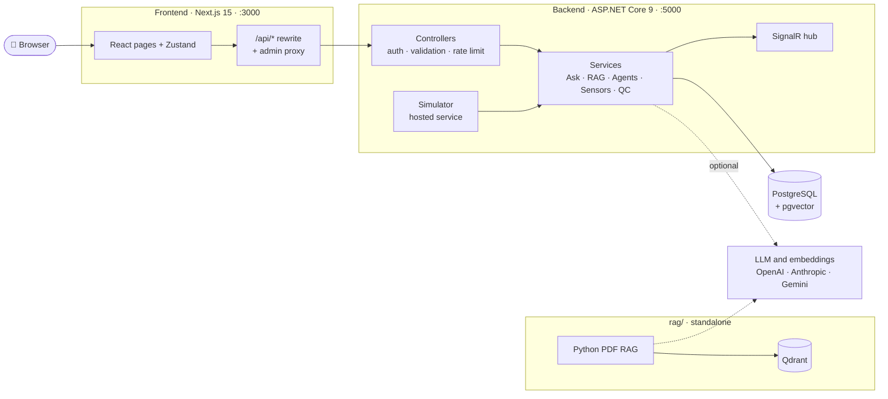

<div align="center">

# 🧵 FactoryBrain

**AI operations platform for Bangladeshi garment (RMG) factories**

Live line throughput · machine health and energy · QC defects · floor alerts ·
AI agents over a factory knowledge graph. Branded **BunonBrain** in the UI, in
English and বাংলা.


[Features](#-features) ·
[Architecture](#-architecture) ·
[Quick start](#-quick-start) ·
[Configuration](#-configuration) ·
[API](#-api-overview) ·
[Project structure](#-project-structure)

</div>

---

## ✨ Features

| | Feature | What it does |
|---|---|---|
| 📊 | **Overview** | Morning brief, line board (throughput and bottlenecks), QC summary, live sensor readings |
| 💬 | **Ask BunonBrain** | Answers questions from manuals and policies with hybrid RAG (vector + BM25) and cites its sources |
| 🤖 | **Agents** | Agent runs with a risk tier, and an approval queue for risky actions |
| 🔍 | **QC and Vision** | Defect logging and flagging, image analysis results |
| 🚨 | **Floor alerts** | Alerts stored by the backend and broadcast over SignalR (`/hubs/factory`) |
| 🎭 | **Demo mode** | With no LLM key, Ask and agent runs return deterministic canned answers |
| 📄 | **PDF RAG (Python)** | Standalone LangChain + Qdrant + Gemini pipeline in [`rag/`](rag/) |

---

## 🏗 Architecture



- The browser talks only to Next.js, which rewrites `/api/*` to the .NET backend.
- The backend owns all data and every AI call. With no keys it still runs: demo
  answers and a local hash vectorizer.
- `rag/` is a separate tool. The backend does not call it.

📐 **Full diagrams** (backend layers, Ask request flow, live data, RAG, security):
[ARCHITECTURE.md](ARCHITECTURE.md)

---

## 🚀 Quick start

### Prerequisites

- Node.js 20+
- .NET 9 SDK
- PostgreSQL with the pgvector extension (local, Docker or Supabase)
- Python 3.11 (only for `rag/`)

### 1. Environment

One `.env` at the repo root configures everything (frontend, API and `rag/`):

```bash
cp .env.example .env        # then fill in FACTORYBRAIN_DB, keys, etc.
```

### 2. Database

Local Docker (matches the default `FACTORYBRAIN_DB`):

```bash
docker run -d --name fb-pg -p 5432:5432 \
  -e POSTGRES_PASSWORD=postgres -e POSTGRES_DB=factorybrain \
  pgvector/pgvector:pg16
```

Or use **Supabase**: take the *Session pooler* string from Dashboard → Connect
and use the Supabase `FACTORYBRAIN_DB` line in `.env`.

### 3. Backend API

```bash
cd FactoryBrain.Backend/FactoryBrain.Api
dotnet run                  # reads the repo-root .env
```

> [!NOTE]
> Only .NET 8 or 10 installed? Run `$env:DOTNET_ROLL_FORWARD = "Major"`
> (PowerShell) first. It has to be set in the shell, not in `.env`.

The API listens on `http://localhost:5000`. On startup it creates the `vector`
extension, applies EF Core migrations and seeds demo data.

- Health check: `GET /health`
- Swagger UI (Development only): `/swagger`

### 4. Frontend

```bash
cd frontend
npm install
npm run dev                 # reads the repo-root .env
```

Open **http://localhost:3000**. Requests to `/api/*` are proxied to the backend
URL in `NEXT_PUBLIC_API_URL` / `DOTNET_API_URL` (default `http://localhost:5000`).

### 5. PDF RAG (optional)

```bash
cd rag
py -3.11 -m venv venv && venv\Scripts\activate      # macOS/Linux: source venv/bin/activate
pip install -r requirements.txt -r requirements-local.txt
# set GOOGLE_API_KEY and the PYRAG_* keys in the repo-root .env
python ingest.py --pdf data/your-file.pdf --recreate
python ask.py "your question"
```

Details: [rag/README.md](rag/README.md)

---

## ⚙ Configuration

**One file for everything:** `.env` at the repo root (template:
[`.env.example`](.env.example), every option explained there). It is git-ignored.
Never commit real values. Real shell or Docker env vars always win over the file.

| App | How it finds the root `.env` | Main keys |
|---|---|---|
| Next.js | `frontend/next.config.mjs` loads it | `NEXT_PUBLIC_API_URL`, `DOTNET_API_URL`, `ADMIN_API_TOKEN` |
| .NET API | `Program.cs` walks up from its working directory | `FACTORYBRAIN_DB`, `JWT_SIGNING_KEY`, `ADMIN_API_TOKEN`, `LLM_*`, `RAG_EMBEDDING_*`, `CORS_ORIGINS`, `SIMULATOR_ENABLED` |
| Python RAG | `rag/config.py` loads `../.env` | `GOOGLE_API_KEY`, `PYRAG_*` |

The Python keys carry a `PYRAG_` prefix so they never clash with the API's
(for example, both have an LLM model setting).

- `ADMIN_API_TOKEN` protects `POST /api/settings/llm`, `/api/rag/ingest` and
  `/api/rag/reindex`. One value now serves both Next.js and the API.

- `JWT_SIGNING_KEY` (32+ bytes) is required in Production.
- `LLM_PROVIDER` can be `openai`, `gemini` or `anthropic`. The key can also be
  entered in **Settings → Advanced**.
- With no embedding key, RAG falls back to a local hash vectorizer.
- `SIMULATOR_ENABLED=true` makes the API generate a live sensor event stream.

---

## 🔌 API overview

| Route | Purpose |
|---|---|
| `/api/auth/{login,refresh,logout,me}` | Cookie/JWT authentication |
| `/api/ask` | Ask a question (RAG + LLM) |
| `/api/agents`, `/api/agents/{id}/run` | List and run agents |
| `/api/brief/morning` | Morning brief |
| `/api/line-board` | Line metrics, `POST /refresh` |
| `/api/sensors/{ingest,live,latest}` | Sensor readings |
| `/api/qc/{defects,flag}` | QC defects |
| `/api/vision/analyze` | Vision results |
| `/api/floor-alerts` | Floor alerts, `PATCH /{id}` |
| `/api/rag/{ingest,reindex,documents,status}` | RAG index management |
| `/api/settings/llm` | LLM settings (admin) |
| `/hubs/factory` | SignalR: `sensorReading`, `lineBoardUpdated`, `floorAlert` |

---

## 🧪 Scripts

Dev and test scripts live in `frontend/scripts/`. Run them from `frontend/`:

```bash
npm run smoke         # dataset, i18n and service contract checks + RAG eval
npm run test:rag      # RAG golden-set check against the running API's /api/ask
npm run probe         # hit every page on a running Next.js server (BASE, default :3000)
npm run sensor:live -- --entity M-101 --vibration 6.4 --temp 82   # push one sensor reading
npm run lint
```

Python RAG tests, from `rag/`:

```bash
pip install -r requirements-dev.txt
python -m pytest -q
```

---

## 🐳 Docker

Build the API image from the repo root:

```bash
docker build -f FactoryBrain.Backend/FactoryBrain.Api/Dockerfile -t factorybrain-api:dev .
docker run -p 8080:8080 -e FACTORYBRAIN_DB="..." -e JWT_SIGNING_KEY="..." factorybrain-api:dev
```

The container listens on port 8080 and runs in Production mode. No secrets are
baked into the image.

---

## 📁 Project structure

```
FactoryBrain/
├── frontend/                  Next.js app
│   ├── src/app/               pages (/app, /app/ask, /app/qc, ...) and admin proxy routes
│   ├── src/components/        UI components
│   ├── src/store/             Zustand stores
│   ├── src/services/          client services and demo datasets
│   ├── src/i18n/              English and Bangla strings
│   └── scripts/               smoke, probe, RAG eval, sensor push
├── FactoryBrain.Backend/      .NET 9 solution
│   ├── FactoryBrain.Api/             controllers, SignalR hub, middleware, Program.cs
│   ├── FactoryBrain.Application/     interfaces, DTOs, validation, RAG scoring
│   ├── FactoryBrain.Infrastructure/  EF Core, migrations, seed, services, embeddings
│   └── FactoryBrain.Domain/          entities and enums
├── database/                  where the schema, migrations and seed data live
├── rag/                       standalone Python PDF RAG (LangChain + Qdrant + Gemini)
├── ARCHITECTURE.md            system diagrams
└── README.md
```

---

## 📄 License

[MIT](LICENSE)
